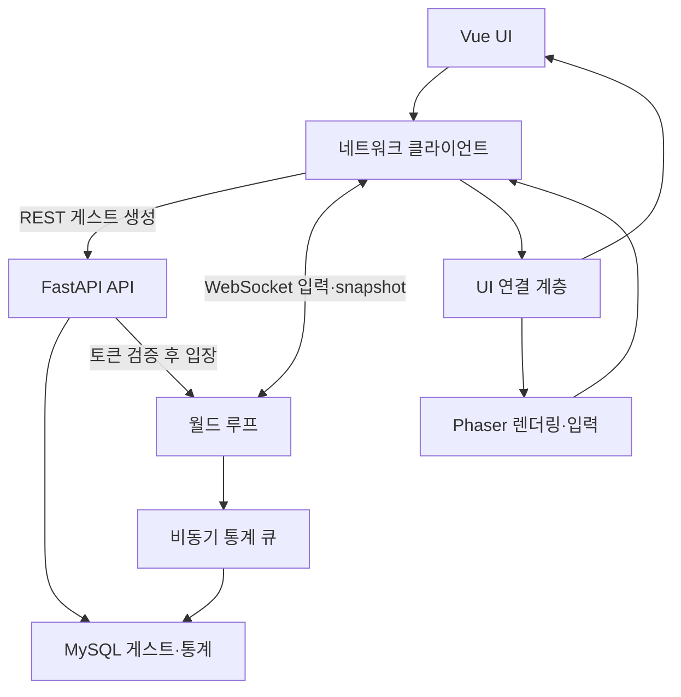

# Phase 0 — 아키텍처와 MVP

## 목표와 가정

하나의 FastAPI 프로세스가 하나의 4096×4096 월드를 소유합니다. 타일은 32×32, 서버는 20 tick/s, 상태는 10회/s, 연결 상한은 20명입니다. 클라이언트는 60FPS를 목표로 렌더링하지만 기기별 실제 프레임률을 보장하지 않습니다.

첫 목표는 2명의 도트 캐릭터가 같은 공간에서 움직이는 것입니다. 이 목표 검증 후 일반 몬스터, 기본 총알, 성장, PvP를 순서대로 추가했습니다. 최초 환경 코드만 모아두지 않고 같은 구조에서 실행 가능한 작은 전투 버전까지 확장했습니다.

닉네임은 표시 이름이므로 중복 가능합니다. UUID가 실제 식별자입니다. 계정 가입 없이 REST로 생성한 게스트 토큰을 현재 탭 메모리에 보관합니다. 새로고침/새 탭은 새 게스트입니다. 현재 페이지의 연결만 끊긴 경우 버튼으로 같은 토큰을 사용해 재접속합니다. DB에 저장한 기록은 남지만 토큰을 잃으면 그 게스트를 다시 인증할 UI는 없습니다.

## 시스템 구조

브라우저 요청은 Nginx 한 곳으로 들어옵니다. `/`는 빌드한 Vue 파일, `/api/*`와 `/ws`는 FastAPI로 전달합니다. 따라서 브라우저 코드에 백엔드 IP를 넣지 않고 동일 출처 URL을 사용합니다. Vite 개발 서버도 같은 경로를 프록시합니다.

Vue의 reactive 상태는 HUD·접속 상태·강화 목록을 관리합니다. Phaser는 스프라이트·보간 좌표·카메라를 관리합니다. 연결 계층 `shared/bridge.ts`가 최신 snapshot을 둘에 전달합니다. 별도의 Pinia는 현재 필요하지 않아 추가하지 않았습니다.

## 데이터 흐름

1. 닉네임 입력 → `POST /api/guests` → MySQL에 UUID·토큰 해시 저장 → 원본 토큰을 한 번 응답합니다.
2. `/ws` 연결 → 첫 메시지 `join` → 서버가 토큰 해시와 DB를 비교하고 월드의 플레이어를 연결합니다. 클라이언트가 player_id를 지정하지 않습니다.
3. 50ms마다 방향과 seq 전송 → 서버가 틱마다 최대 한 입력을 처리 → 속도 정규화·경계·장애물 적용 → 위치 확정합니다.
4. 서버 snapshot의 seq는 실제 처리한 입력 번호입니다. 클라이언트는 미확인 입력을 재실행해 위치를 예측하고 최신 서버 위치로 보정합니다. 다른 캐릭터는 서버 위치를 부드럽게 보간합니다.
5. 100ms마다 플레이어 주변 사각 AOI의 엔티티만 보냅니다. AOI는 좌우950, 상하650 좌표입니다. 화면 확대율도 표시 범위가 AOI 안에 있도록 제한합니다. 랭킹은 이름·킬·레벨만 별도로 보냅니다.
6. 몬스터 AI·타깃 선택·총알 생성·선분 충돌·피해·EXP·강화·사망은 서버가 판정합니다. 클라이언트는 이를 그립니다.
7. 통계 이벤트 → bounded 비동기 큐 → SQLAlchemy worker → MySQL 원자적 누적 갱신. 위치와 총알은 DB에 쓰지 않습니다.

매프레임 Vue 컴포넌트를 통해 게임 객체를 조작하지 않습니다. REST는 일반 요청/응답, WS는 지속되는 양방향 연결, 월드 루프는 DB의 배치와 다른 고정 간격 계산입니다.

## 현재 MVP 요구사항

- 게스트 생성·인증, Origin 검사, 중복 연결 거부, 5초 재접속 유예, 수동 재접속
- WASD/방향키, 대각선 정규화, 경계·장애물, 카메라, 직접 만든 도트·걷기 애니메이션
- 일반 몬스터 자동 생성(최대80)·간단 추적·근접 피해
- 가장 가까운 유효 대상에게 자동 원거리 공격(최대240 투사체)
- 몬스터 EXP15, 보상 가능한 PvP EXP30, 레벨 요구 EXP=`현재레벨 × 30`
- 공격력/속도/체력 강화, Lv.3부터 확산탄·회전 무기 후보 추가
- 레벨 자체에는 상한 없음. 공격력80·체력300·쿨다운0.2초 하한, 이동 속도220 고정
- 안전구역 반경90. 안에서는 공격/피해 없음. 최초 입장/리스폰 3초 보호
- 사망 후3초 대기, 전투 레벨/무기/강화 초기화, 킬·데스·최고레벨은 영구 통계로 저장
- 같은 공격자/희생자 조합은60초 동안 추가 킬점수/EXP 없음. 사망·데스와 킬 피드는 계속 반영
- 범위 사망 시 전체 월드 초기화 없음. 나간 플레이어는5초 후 월드에서 제거

## 제외 또는 후속 기능

일반 회원가입, 토큰 분실 복구, 모바일 터치 조작, 음향, 설정 화면, 빠른/원거리/정예 몬스터, A* 경로 탐색, 랜덤 맵, 무기 진화, 정교한 PvP 매칭/밸런스, 별도 맵 샤딩, Redis/Kafka/Kubernetes, Delta snapshot, 영구 월드 상태 저장, 강제 종료에도 유실 없는 이벤트 큐는 제외합니다.

회전 무기는 서버가 회전 위치 주변 접촉 범위를 판정하는 작은 구현입니다. 확산탄은 기본 총알의 발사 수를3개로 늘립니다. 서버 공간 분할을 적용했지만 Python 객체 풀은 현재 상한에서 필요한지 측정한 뒤 도입합니다.

## DB 모델

실제 사용하는 `guest_accounts` 한 테이블만 만들었습니다. 필요해질 때 프로필·게임 세션·개별 처치 기록을 분리합니다.

| 컬럼 | 역할 |
|---|---|
| id PK | 서버 발급 UUID |
| nickname INDEX | 표시 이름, 중복 가능 |
| token_hash UNIQUE | SHA-256 토큰 해시, 원본 토큰 미저장 |
| kills / deaths | 영구 누적 |
| best_level | 최고 전투 레벨 |
| created_at | 생성 시각 |

Alembic `0001`로 테이블을 생성합니다. 통계 증가는 SQL에서 `현재값 + 증가량`으로 계산하여 동시 갱신 손실을 줄입니다. 이벤트 큐가 메모리이므로 강제 종료·DB 장애 시 일부 기록이 유실될 수 있습니다. 실패 수는 health와 로그에서 확인합니다. 현재 정확히 한 번의 내구성 저장을 보장하지 않습니다.

## 상태 수명과 확장

DB의 게스트·통계는 볼륨에 남습니다. 플레이어 좌표·HP·몬스터·총알·현재 성장·월드 랭킹은 서버 재시작 시 초기화됩니다. 누적 랭킹은 REST로 별도 조회합니다.

FastAPI workers=1을 유지해야 합니다. 여러 worker를 켜면 각각 다른 월드가 생깁니다. 확장은 측정 후 월드 소유권과 세션 라우팅을 설계하고 진행합니다. FastAPI API, 순수 게임 함수, SQLAlchemy repository를 나눠 이후 다른 서버 프레임워크로 바꿀 때 프로토콜/규칙을 재사용할 수 있도록 했습니다.

## 전체 프로젝트 경로

| 경로 | 종류 |
|---|---|
| `.env.example` | 코드·설정·문서 |
| `.github/workflows/README.md` | 코드·설정·문서 |
| `.github/workflows/check.yml` | 코드·설정·문서 |
| `.gitignore` | 코드·설정·문서 |
| `README.md` | 코드·설정·문서 |
| `backend/.dockerignore` | 코드·설정·문서 |
| `backend/Dockerfile` | 코드·설정·문서 |
| `backend/README.md` | 코드·설정·문서 |
| `backend/alembic.ini` | 코드·설정·문서 |
| `backend/app/README.md` | 코드·설정·문서 |
| `backend/app/__init__.py` | 코드·설정·문서 |
| `backend/app/api/README.md` | 코드·설정·문서 |
| `backend/app/api/__init__.py` | 코드·설정·문서 |
| `backend/app/api/rest.py` | 코드·설정·문서 |
| `backend/app/api/websocket.py` | 코드·설정·문서 |
| `backend/app/core/README.md` | 코드·설정·문서 |
| `backend/app/core/__init__.py` | 코드·설정·문서 |
| `backend/app/core/config.py` | 코드·설정·문서 |
| `backend/app/game/README.md` | 코드·설정·문서 |
| `backend/app/game/__init__.py` | 코드·설정·문서 |
| `backend/app/game/combat.py` | 코드·설정·문서 |
| `backend/app/game/combat_events.py` | 코드·설정·문서 |
| `backend/app/game/entities.py` | 코드·설정·문서 |
| `backend/app/game/map.py` | 코드·설정·문서 |
| `backend/app/game/movement.py` | 코드·설정·문서 |
| `backend/app/game/progression.py` | 코드·설정·문서 |
| `backend/app/game/protocol.py` | 코드·설정·문서 |
| `backend/app/game/spatial.py` | 코드·설정·문서 |
| `backend/app/game/world.py` | 코드·설정·문서 |
| `backend/app/main.py` | 코드·설정·문서 |
| `backend/app/persistence/README.md` | 코드·설정·문서 |
| `backend/app/persistence/__init__.py` | 코드·설정·문서 |
| `backend/app/persistence/database.py` | 코드·설정·문서 |
| `backend/app/persistence/models.py` | 코드·설정·문서 |
| `backend/app/persistence/repository.py` | 코드·설정·문서 |
| `backend/migrations/README.md` | 코드·설정·문서 |
| `backend/migrations/env.py` | 코드·설정·문서 |
| `backend/migrations/script.py.mako` | 코드·설정·문서 |
| `backend/migrations/versions/0001_guests.py` | 코드·설정·문서 |
| `backend/migrations/versions/README.md` | 코드·설정·문서 |
| `backend/requirements.txt` | 코드·설정·문서 |
| `backend/tests/README.md` | 코드·설정·문서 |
| `backend/tests/__init__.py` | 코드·설정·문서 |
| `backend/tests/conftest.py` | 코드·설정·문서 |
| `backend/tests/test_combat.py` | 코드·설정·문서 |
| `backend/tests/test_combat_events.py` | 코드·설정·문서 |
| `backend/tests/test_movement.py` | 코드·설정·문서 |
| `backend/tests/test_network.py` | 코드·설정·문서 |
| `backend/tests/test_security.py` | 코드·설정·문서 |
| `compose.dev.yaml` | 코드·설정·문서 |
| `compose.tls.yaml` | 코드·설정·문서 |
| `compose.yaml` | 코드·설정·문서 |
| `docs/README.md` | 코드·설정·문서 |
| `docs/architecture.md` | 코드·설정·문서 |
| `docs/assets-v1.md` | 코드·설정·문서 |
| `docs/assets-v2.md` | 코드·설정·문서 |
| `docs/assets-v3.md` | 코드·설정·문서 |
| `docs/benchmark-before.png` | PNG 에셋/실제 검증 화면 |
| `docs/benchmark-v1-baseline.png` | PNG 에셋/실제 검증 화면 |
| `docs/benchmark-v1.png` | PNG 에셋/실제 검증 화면 |
| `docs/benchmark-v2-baseline.png` | PNG 에셋/실제 검증 화면 |
| `docs/benchmark-v2.png` | PNG 에셋/실제 검증 화면 |
| `docs/benchmark-v3.png` | PNG 에셋/실제 검증 화면 |
| `docs/combat-replay-v3.png` | PNG 에셋/실제 검증 화면 |
| `docs/death-live-v4.png` | PNG 에셋/실제 검증 화면 |
| `docs/death-v4-1366.png` | PNG 에셋/실제 검증 화면 |
| `docs/design-system-v4.md` | 코드·설정·문서 |
| `docs/hud-live-v4-1366.png` | PNG 에셋/실제 검증 화면 |
| `docs/hud-live-v4-1920.png` | PNG 에셋/실제 검증 화면 |
| `docs/hud-live-v4-2560.png` | PNG 에셋/실제 검증 화면 |
| `docs/hud-v4-1366-1.25.png` | PNG 에셋/실제 검증 화면 |
| `docs/imagegen-prompt-v1.txt` | 코드·설정·문서 |
| `docs/imagegen-prompt-v3.txt` | 코드·설정·문서 |
| `docs/imagegen-prompts-v2.json` | 코드·설정·문서 |
| `docs/load-result.json` | 코드·설정·문서 |
| `docs/menu-live-v4.png` | PNG 에셋/실제 검증 화면 |
| `docs/operations.md` | 코드·설정·문서 |
| `docs/phase-v1.md` | 코드·설정·문서 |
| `docs/phase-v2.md` | 코드·설정·문서 |
| `docs/phase-v3.md` | 코드·설정·문서 |
| `docs/phase-v4.md` | 코드·설정·문서 |
| `docs/preview-after-v1.png` | PNG 에셋/실제 검증 화면 |
| `docs/preview-after-v2.png` | PNG 에셋/실제 검증 화면 |
| `docs/preview-after-v3.png` | PNG 에셋/실제 검증 화면 |
| `docs/preview-after-v4.png` | PNG 에셋/실제 검증 화면 |
| `docs/preview-before-v1.png` | PNG 에셋/실제 검증 화면 |
| `docs/preview.png` | PNG 에셋/실제 검증 화면 |
| `docs/protocol.md` | 코드·설정·문서 |
| `docs/pvp-v3.png` | PNG 에셋/실제 검증 화면 |
| `docs/respawn-v2.png` | PNG 에셋/실제 검증 화면 |
| `docs/respawn-v3.png` | PNG 에셋/실제 검증 화면 |
| `docs/roadmap.md` | 코드·설정·문서 |
| `docs/settings-v4.png` | PNG 에셋/실제 검증 화면 |
| `docs/soak-v3.png` | PNG 에셋/실제 검증 화면 |
| `docs/upgrade-applied-live-v4.png` | PNG 에셋/실제 검증 화면 |
| `docs/upgrade-v4-1366.png` | PNG 에셋/실제 검증 화면 |
| `docs/v1-asset-validation.json` | 코드·설정·문서 |
| `docs/v1-performance.json` | 코드·설정·문서 |
| `docs/v2-asset-validation.json` | 코드·설정·문서 |
| `docs/v2-changes.json` | 코드·설정·문서 |
| `docs/v2-performance.json` | 코드·설정·문서 |
| `docs/v2-preservation.json` | 코드·설정·문서 |
| `docs/v3-asset-validation.json` | 코드·설정·문서 |
| `docs/v3-changes.json` | 코드·설정·문서 |
| `docs/v3-performance-initial.json` | 코드·설정·문서 |
| `docs/v3-performance.json` | 코드·설정·문서 |
| `docs/v3-preservation.json` | 코드·설정·문서 |
| `docs/v3-rule-comparison.json` | 코드·설정·문서 |
| `docs/v3-soak-samples.jsonl` | 코드·설정·문서 |
| `docs/v3-soak.json` | 코드·설정·문서 |
| `docs/v3-validation.json` | 코드·설정·문서 |
| `docs/v4-changes.json` | 코드·설정·문서 |
| `docs/v4-performance.json` | 코드·설정·문서 |
| `docs/v4-preservation.json` | 코드·설정·문서 |
| `docs/v4-validation.json` | 코드·설정·문서 |
| `docs/validation.md` | 코드·설정·문서 |
| `frontend/.dockerignore` | 코드·설정·문서 |
| `frontend/Dockerfile` | 코드·설정·문서 |
| `frontend/README.md` | 코드·설정·문서 |
| `frontend/index.html` | 코드·설정·문서 |
| `frontend/nginx.conf` | 코드·설정·문서 |
| `frontend/package-lock.json` | 코드·설정·문서 |
| `frontend/package.json` | 코드·설정·문서 |
| `frontend/playwright.config.ts` | 코드·설정·문서 |
| `frontend/public/README.md` | 코드·설정·문서 |
| `frontend/public/assets/README.md` | 코드·설정·문서 |
| `frontend/public/assets/ambient/README.md` | 코드·설정·문서 |
| `frontend/public/assets/ambient/dust-v1.png` | PNG 에셋/실제 검증 화면 |
| `frontend/public/assets/ambient/shadow-v1.png` | PNG 에셋/실제 검증 화면 |
| `frontend/public/assets/animations/README.md` | 코드·설정·문서 |
| `frontend/public/assets/animations/entity-v2.json` | 코드·설정·문서 |
| `frontend/public/assets/characters/README.md` | 코드·설정·문서 |
| `frontend/public/assets/characters/player-source-v2.png` | PNG 에셋/실제 검증 화면 |
| `frontend/public/assets/characters/player-v2.png` | PNG 에셋/실제 검증 화면 |
| `frontend/public/assets/effects/README.md` | 코드·설정·문서 |
| `frontend/public/assets/effects/combat-v3.png` | PNG 에셋/실제 검증 화면 |
| `frontend/public/assets/effects/manifest-v3.json` | 코드·설정·문서 |
| `frontend/public/assets/effects/source-v3.png` | PNG 에셋/실제 검증 화면 |
| `frontend/public/assets/environment/README.md` | 코드·설정·문서 |
| `frontend/public/assets/environment/fir-canopy-v1.png` | PNG 에셋/실제 검증 화면 |
| `frontend/public/assets/environment/oak-canopy-v1.png` | PNG 에셋/실제 검증 화면 |
| `frontend/public/assets/environment/source-atlas-v1.png` | PNG 에셋/실제 검증 화면 |
| `frontend/public/assets/manifest-v1.json` | 코드·설정·문서 |
| `frontend/public/assets/monsters/README.md` | 코드·설정·문서 |
| `frontend/public/assets/monsters/ghoul-source-v2.png` | PNG 에셋/실제 검증 화면 |
| `frontend/public/assets/monsters/ghoul-v2.png` | PNG 에셋/실제 검증 화면 |
| `frontend/public/assets/particles/README.md` | 코드·설정·문서 |
| `frontend/public/assets/particles/ember-v3.png` | PNG 에셋/실제 검증 화면 |
| `frontend/public/assets/particles/shard-v3.png` | PNG 에셋/실제 검증 화면 |
| `frontend/public/assets/projectiles/README.md` | 코드·설정·문서 |
| `frontend/public/assets/projectiles/hostile-bolt-v3.png` | PNG 에셋/실제 검증 화면 |
| `frontend/public/assets/projectiles/orbit-blade-v3.png` | PNG 에셋/실제 검증 화면 |
| `frontend/public/assets/projectiles/own-bolt-v3.png` | PNG 에셋/실제 검증 화면 |
| `frontend/public/assets/projectiles/spread-bolt-v3.png` | PNG 에셋/실제 검증 화면 |
| `frontend/public/assets/props/README.md` | 코드·설정·문서 |
| `frontend/public/assets/props/boulder-v1.png` | PNG 에셋/실제 검증 화면 |
| `frontend/public/assets/props/dead-tree-v1.png` | PNG 에셋/실제 검증 화면 |
| `frontend/public/assets/props/fir-v1.png` | PNG 에셋/실제 검증 화면 |
| `frontend/public/assets/props/oak-v1.png` | PNG 에셋/실제 검증 화면 |
| `frontend/public/assets/props/pillar-v1.png` | PNG 에셋/실제 검증 화면 |
| `frontend/public/assets/props/rubble-v1.png` | PNG 에셋/실제 검증 화면 |
| `frontend/public/assets/props/wall-v1.png` | PNG 에셋/실제 검증 화면 |
| `frontend/public/assets/tiles/README.md` | 코드·설정·문서 |
| `frontend/public/assets/tiles/details-v1.png` | PNG 에셋/실제 검증 화면 |
| `frontend/public/assets/tiles/ground-v1.png` | PNG 에셋/실제 검증 화면 |
| `frontend/scripts/README.md` | 코드·설정·문서 |
| `frontend/scripts/benchmark-v2.mjs` | 코드·설정·문서 |
| `frontend/scripts/benchmark-v3.mjs` | 코드·설정·문서 |
| `frontend/scripts/benchmark-v4.mjs` | 코드·설정·문서 |
| `frontend/scripts/soak-v3.mjs` | 코드·설정·문서 |
| `frontend/src/App.vue` | 코드·설정·문서 |
| `frontend/src/README.md` | 코드·설정·문서 |
| `frontend/src/components/DeathOverlay.vue` | 코드·설정·문서 |
| `frontend/src/components/GameCanvas.vue` | 코드·설정·문서 |
| `frontend/src/components/GameHud.vue` | 코드·설정·문서 |
| `frontend/src/components/GameSettings.vue` | 코드·설정·문서 |
| `frontend/src/components/JoinPanel.vue` | 코드·설정·문서 |
| `frontend/src/components/README.md` | 코드·설정·문서 |
| `frontend/src/components/UpgradeSelection.vue` | 코드·설정·문서 |
| `frontend/src/components/ui/GameIcon.vue` | 코드·설정·문서 |
| `frontend/src/components/ui/Leaderboard.vue` | 코드·설정·문서 |
| `frontend/src/components/ui/README.md` | 코드·설정·문서 |
| `frontend/src/components/ui/VitalBars.vue` | 코드·설정·문서 |
| `frontend/src/components/ui/WeaponPanel.vue` | 코드·설정·문서 |
| `frontend/src/game/README.md` | 코드·설정·문서 |
| `frontend/src/game/combat/README.md` | 코드·설정·문서 |
| `frontend/src/game/combat/assets.ts` | 코드·설정·문서 |
| `frontend/src/game/combat/effects.ts` | 코드·설정·문서 |
| `frontend/src/game/combat/manager.ts` | 코드·설정·문서 |
| `frontend/src/game/combat/pool.ts` | 코드·설정·문서 |
| `frontend/src/game/combat/projectiles.ts` | 코드·설정·문서 |
| `frontend/src/game/createGame.ts` | 코드·설정·문서 |
| `frontend/src/game/input.ts` | 코드·설정·문서 |
| `frontend/src/game/prediction.ts` | 코드·설정·문서 |
| `frontend/src/game/scene.ts` | 코드·설정·문서 |
| `frontend/src/game/visuals/README.md` | 코드·설정·문서 |
| `frontend/src/game/visuals/animations.ts` | 코드·설정·문서 |
| `frontend/src/game/visuals/assets.ts` | 코드·설정·문서 |
| `frontend/src/game/visuals/renderers.ts` | 코드·설정·문서 |
| `frontend/src/game/visuals/state.ts` | 코드·설정·문서 |
| `frontend/src/game/world/README.md` | 코드·설정·문서 |
| `frontend/src/game/world/assets.ts` | 코드·설정·문서 |
| `frontend/src/game/world/environment.ts` | 코드·설정·문서 |
| `frontend/src/game/world/layout.ts` | 코드·설정·문서 |
| `frontend/src/main.ts` | 코드·설정·문서 |
| `frontend/src/network/README.md` | 코드·설정·문서 |
| `frontend/src/network/client.ts` | 코드·설정·문서 |
| `frontend/src/shared/README.md` | 코드·설정·문서 |
| `frontend/src/shared/bridge.ts` | 코드·설정·문서 |
| `frontend/src/shared/preferences.ts` | 코드·설정·문서 |
| `frontend/src/shared/presentation.ts` | 코드·설정·문서 |
| `frontend/src/shared/protocol.ts` | 코드·설정·문서 |
| `frontend/src/style.css` | 코드·설정·문서 |
| `frontend/src/ui/README.md` | 코드·설정·문서 |
| `frontend/src/ui/game-ui.css` | 코드·설정·문서 |
| `frontend/src/ui/tokens.css` | 코드·설정·문서 |
| `frontend/tests/README.md` | 코드·설정·문서 |
| `frontend/tests/a-growth-ui.spec.ts` | 코드·설정·문서 |
| `frontend/tests/a-pvp-effects.spec.ts` | 코드·설정·문서 |
| `frontend/tests/combat-effects.spec.ts` | 코드·설정·문서 |
| `frontend/tests/environment.spec.ts` | 코드·설정·문서 |
| `frontend/tests/multiplayer.spec.ts` | 코드·설정·문서 |
| `frontend/tests/support/isolatedArena.ts` | 코드·설정·문서 |
| `frontend/tests/ui-v4.spec.ts` | 코드·설정·문서 |
| `frontend/tests/visuals.spec.ts` | 코드·설정·문서 |
| `frontend/tests/z-combat-visuals.spec.ts` | 코드·설정·문서 |
| `frontend/tsconfig.json` | 코드·설정·문서 |
| `frontend/vite.config.ts` | 코드·설정·문서 |
| `infra/README.md` | 코드·설정·문서 |
| `infra/nginx.tls.conf` | 코드·설정·문서 |
| `scripts/README.md` | 코드·설정·문서 |
| `scripts/build_environment_assets.py` | 코드·설정·문서 |
| `scripts/init_env.py` | 코드·설정·문서 |
| `scripts/load_test.py` | 코드·설정·문서 |
| `scripts/requirements-assets.txt` | 코드·설정·문서 |
| `tools/README.md` | 코드·설정·문서 |
| `tools/build_combat_assets.py` | 코드·설정·문서 |
| `tools/build_entity_atlases.py` | 코드·설정·문서 |
| `tools/compare_v2_rules.py` | 코드·설정·문서 |
| `tools/requirements.txt` | 코드·설정·문서 |
